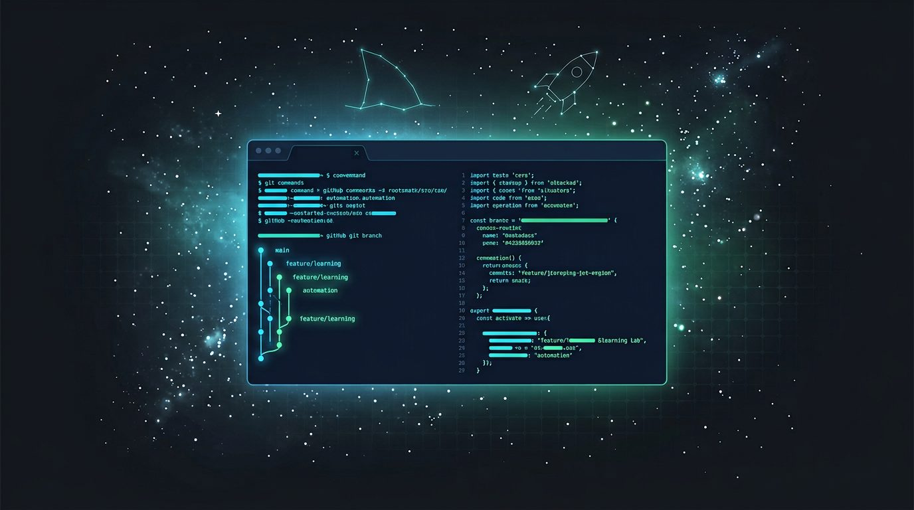
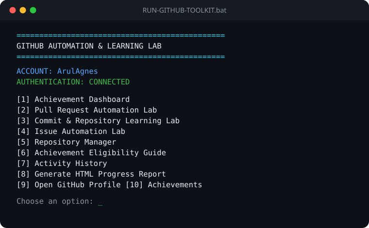

# GitHub Automation & Learning Lab



A **double-clickable Windows toolkit** that teaches Git, GitHub, PowerShell and BAT
automation while tracking your progress toward the currently obtainable GitHub
achievements - honestly. It never fakes merges, stars, collaborators, reviews or
accepted answers, and it never bypasses branch protection.

> Built for **ArulAgnes** (Windows 11, PowerShell 5.1 / 7, Git + GitHub CLI).
> Works for any account - just change `expectedGitHubUsername` in `config/settings.json`.

---

## Table of contents

- [Features](#features)
- [Quick start (double-click)](#quick-start-double-click)
- [What you will learn](#what-you-will-learn)
- [Achievement trackers](#achievement-trackers)
- [Project layout](#project-layout)
- [Example output](#example-output)
- [Safety guarantees](#safety-guarantees)
- [Testing](#testing)
- [Documentation](#documentation)
- [Honest eligibility summary](#honest-eligibility-summary)
- [Version](#version)

---

## Features

| Area | What the toolkit does |
|------|----------------------|
| **One-click startup** | Double-click the BAT → OS/PowerShell check → Git & GitHub CLI detection (winget install offered) → GitHub browser sign-in → account verification → repository scan → dashboard |
| **Main dashboard** | Colored console UI, numbered menu, dry-run toggle, activity badges |
| **PR Automation Lab** | Finds a *genuine* missing-file improvement, previews it, creates a branch, commits with a real Conventional Commit message, pushes, opens the PR, checks mergeability + required checks, self-merges **only** when repository rules permit |
| **Pull Shark tracker** | Live merged-PR count via the GitHub search API, tier math (2 / 16 / 128 / 1,024), remaining count, recent PR links, last-merge detection |
| **Quickdraw lab** | Learn the issue lifecycle; quality-gated issue creation; close-within-5-minutes eligibility tracking |
| **Pair Extraordinaire** | Explains `Co-authored-by:`, verifies the collaborator exists + gets explicit consent, scans merged PRs for the trailer (1 / 10 / 24 / 48) |
| **Galaxy Brain** | Finds discussions you can genuinely answer, drafts answers with you, verifies "accepted answer" via GraphQL and counts only your *own* accepted answers |
| **Starstruck tracker** | Actual star counts per repo from the API, tier math (16 / 128 / 512 / 4,096), honest growth guidance |
| **Learning content generator** | Seeds the dedicated learning repo with real tutorials (Git, BAT, PowerShell, gh CLI), working demo code, a demo test harness, troubleshooting + achievement guides |
| **HTML progress report** | Self-contained report: account, repos, stars, merged PRs, all trackers, eligibility table, recent activity - opens offline |
| **Safety** | No force-push, no deletions, secret scan before every commit, automatic backups before overwrite, `$LASTEXITCODE` checked, conflicts stop the toolkit, dry-run mode |
| **Tests** | Dependency-free PowerShell suite + Windows manual test plan (34 scenarios) |

---

## Quick start (double-click)

1. Install [Git for Windows](https://git-scm.com/download/win) and the
   [GitHub CLI](https://cli.github.com/) — or let the toolkit offer to install them via winget.
2. Extract the ZIP anywhere, e.g. `C:\Tools\github-automation-toolkit`.
3. Double-click **`RUN-GITHUB-TOOLKIT.bat`**.
4. A browser opens for GitHub sign-in (first run only). Approve the device code.
5. The dashboard appears:



Full walkthrough: [INSTALLATION.md](INSTALLATION.md) · Safety model: [SAFETY.md](SAFETY.md)

---

## What you will learn

The dedicated learning repository (`github-learning-lab`, created from menu **[5]**)
is seeded with genuine educational content you work through at your own pace:

1. **Git basics** — working tree / index / HEAD, everyday loop, safe undos, Conventional Commits
2. **Branching & merging** — `git switch -c`, squash vs merge, conflict anatomy and recovery
3. **GitHub CLI** — `gh auth`, `gh repo`, `gh issue`, `gh pr`, search API queries
4. **BAT scripting** — `%~dp0`, `setlocal`, CRLF rules, errorlevel handling, safe launchers
5. **PowerShell automation** — 5.1/7 dual compatibility, `$LASTEXITCODE` discipline, JSON handling
6. **Testing** — a tiny dependency-free test harness demo (`tests/Test-Calculator.ps1`)

---

## Achievement trackers

> ⚠️ GitHub publishes almost nothing officially. All thresholds are
> **community-reported** and may change without notice.

| Achievement | Reported tiers | How the toolkit helps | Needs other people? |
|---|---|---|---|
| **Pull Shark** | 2 / 16 / 128 / 1,024 merged PRs | PR lab + live API counter | Reviewers help; merge counts when the PR merges |
| **Quickdraw** | close an issue ≤ 5 min | Issue lab with timer + eligibility log | No |
| **Pair Extraordinaire** | 1 / 10 / 24 / 48 co-authored merged PRs | Trailer guide, collaborator verification + consent, scan | **Yes — a real collaborator** |
| **Galaxy Brain** | 2 / 8 / 16 / 32 accepted answers | Find questions, draft, verify acceptance via GraphQL | **Yes — community/maintainer acceptance** |
| **Starstruck** | 16 / 128 / 512 / 4,096 stars | Actual counts, progress bar, honest guidance | **Yes — users starring your repo** |
| **YOLO** | merge a PR without review | Explained (you already hold it) | No |
| **Public Sponsor** | sponsor a developer | Explained; external action | **Yes — a sponsor + GitHub Sponsors** |
| Arctic Code Vault / Mars 2020 | — | Reference only — **retired, unobtainable** | n/a |
| Heart On Your Sleeve | unclear / experimental | Reference only — not reliably earnable | n/a |

The toolkit itself can move **Pull Shark, Quickdraw, Starstruck, Pair Extraordinaire,
Galaxy Brain**. It cannot create the human ingredients for the others, and it will
never pretend to.

---

## Project layout

```
github-automation-toolkit/
├── RUN-GITHUB-TOOLKIT.bat      # double-click entry point
├── src/
│   ├── Main.ps1                # startup + dashboard loop
│   ├── Common.ps1              # UI, logging, settings, secret scan, backups
│   ├── Authentication.ps1      # OS check, tool detection/winget, gh sign-in
│   ├── RepositoryManager.ps1   # repo listing, permissions, learning repo + content
│   ├── CommitManager.ps1       # git status/branch/commit/push, conflict guidance
│   ├── PullRequestManager.ps1  # PR discovery/preview/create/merge + Pull Shark data
│   ├── IssueManager.ps1        # Quickdraw workflow + 5-minute tracking
│   ├── AchievementTracker.ps1  # all trackers + eligibility reference
│   └── ReportGenerator.ps1     # self-contained HTML report
├── config/settings.json        # expected account, limits, thresholds, safety flags
├── data/activity-log.json      # append-only JSON log of everything the toolkit does
├── docs/assets/                # README artwork
├── tests/
│   ├── TestCommon.ps1          # mini test framework (no Pester dependency)
│   ├── Run-Tests.ps1           # automated suite
│   └── MANUAL-TEST-PLAN.md     # 34-scenario Windows checklist
├── README.md · INSTALLATION.md · SAFETY.md · CHANGELOG.md
└── reports/                    # generated HTML reports land here
```

---

## Example output

```
==============================================
       GITHUB AUTOMATION & LEARNING LAB
==============================================
ACCOUNT: ArulAgnes
AUTHENTICATION: CONNECTED

[1] Achievement Dashboard
[2] Pull Request Automation Lab
[3] Commit & Repository Learning Lab
[4] Issue Automation Lab
[5] Repository Manager
[6] Achievement Eligibility Guide
[7] Activity History
[8] Generate HTML Progress Report
[9] Open GitHub Profile
[10] Open GitHub Achievements
[D] Toggle dry-run mode
[0] Exit
==============================================
```

Pull Shark detail (live API):

```
QUALIFIYING MERGED PRs: 7
Current tier: Pull Shark
Next tier:    Bronze at 16 merged PRs
Remaining:    9 qualifying PRs
[##############----------------]  44%  7/16  Bronze
```

## Safety guarantees

- ❌ Never force-pushes, never rewrites pushed history
- ❌ Never deletes repositories or branches
- ❌ Never commits files that look like secrets (`.env`, `*.pem`, `ghp_*`, …)
- ❌ Never bypasses branch protection or required checks
- ❌ Never stores passwords / tokens in the project (GitHub CLI keeps its own secure store)
- ❌ Never fabricates merges, stars, collaborators, accepted answers or reviews
- ✅ Backs up any file before overwriting (`.backups/`)
- ✅ Dry-run mode for every mutating workflow
- ✅ Every external command’s `$LASTEXITCODE` is checked
- ✅ Merge conflicts stop the toolkit; recovery steps are printed, never auto-resolved
- ✅ Machine-wide PowerShell execution policy is never changed

Read the full model: [SAFETY.md](SAFETY.md)

## Testing

```
powershell.exe -NoProfile -ExecutionPolicy Bypass -File .\tests\Run-Tests.ps1
```

The suite covers settings parsing, the activity log, all tier calculators, the
secret scanner, branch validation, backups, PR check evaluation, issue-quality
gates, offline report generation and a parse-check of every shipped `.ps1`.

**Platform honesty:** this project was authored and statically verified on Linux.
The automated suite is written to pass on Windows PowerShell 5.1 / PowerShell 7
but **has not been executed on Windows in the authoring environment** — see
[INSTALLATION.md](INSTALLATION.md#test-report) for the manual test plan that
completes verification on your machine.

## Documentation

| File | Purpose |
|---|---|
| [INSTALLATION.md](INSTALLATION.md) | Step-by-step double-click guide, winget installs, SmartScreen notes |
| [SAFETY.md](SAFETY.md) | Threat model, guarantees, failure handling |
| [CHANGELOG.md](CHANGELOG.md) | Release history |
| [tests/MANUAL-TEST-PLAN.md](tests/MANUAL-TEST-PLAN.md) | 34-scenario Windows verification checklist |
| [docs/ACHIEVEMENT-REFERENCE.md](docs/ACHIEVEMENT-REFERENCE.md) | Deep-dive eligibility reference |

## Honest eligibility summary

- **You can realistically pursue now:** Pull Shark (higher tiers), Quickdraw,
  Pair Extraordinaire (with a willing co-author), Galaxy Brain (by answering real
  questions), Starstruck (by shipping something useful).
- **Requires someone else to act:** Public Sponsor (a sponsoring developer),
  Starstruck (stargazers), Galaxy Brain (acceptance), Pair Extraordinaire
  (co-author), Pull Shark (merged PR — though your own repos can self-merge).
- **Unobtainable today:** Arctic Code Vault Contributor, Mars 2020 Helicopter
  Contributor (retired); Heart On Your Sleeve (experimental/unreliable).

No tool — including this one — can unlock every badge. The toolkit’s job is to
remove the *mechanical* friction (setup, branches, commits, PRs, tracking) so
your genuine work gets credited, and to tell you the truth about the rest.

## Version

**v1.0.0** — 2026-11-21 · See [CHANGELOG.md](CHANGELOG.md)
